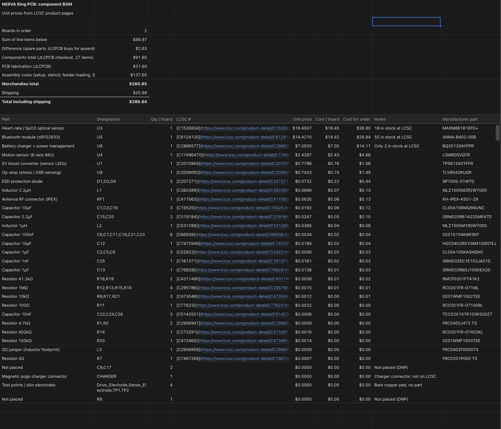

# NERVA Ring

An open-source, sensor-packed smart ring designed to monitor cognitive health and autonomic nervous system metrics rather than traditional fitness tracking.

## Project Overview

The NERVA Ring shifts the focus of wearable technology away from step-counting and workouts toward real-time mental well-being. By embedding precise biosensors into a compact, flexible PCB form factor, the device continuously captures physiological indicators tied directly to stress, mental fatigue, and psychological arousal.

## Core Features

* **Cognitive Focus:** Tailored strictly for mental wellness monitoring rather than physical fitness or gym tracking.
* **Reviewed Hardware Design:** The v1 circuitry was modeled and validated in LT-Spice; the v2 netlist has been reviewed pin-by-pin against every device datasheet. No v2 board has been built or bench-validated yet.
* **Ultra-Compact Layout:** All hardware components optimized to fit onto a highly constrained, circular flex PCB architecture.
* **Wireless Telemetry:** Real-time, low-latency data streaming to mobile devices using Bluetooth Low Energy (BLE).
* **Intelligent Software Pipeline:** Dynamic in-app data filtering to remove motion artifacts and anomalies, powering a custom algorithm that delivers a "Cognitive Score" out of 100 alongside meaningful behavioral insights.


### Core components

| Role | Part | I²C address (7-bit) |
|------|------|---------------------|
| MCU / BLE | u-blox ANNA-B402-00B (nRF52833) | — |
| PPG (HR / SpO2) | MAXM86161 | `0x62` (`0xC4`/`0xC5` 8-bit) |
| IMU + die temperature | ST LSM6DSV | `0x6B` — SA0 tied to 1V8 |
| PMIC / charger / fuel gauge | TI BQ25120A | `0x6A` (fixed) |
| GSR analog front end | TI OPA2333 (dual op-amp) | — |
| LED boost converter | TI TPS61240 (fixed 5 V) | — |

All three I²C devices share a single bus. The IMU sits at **`0x6B`, not the ST default `0x6A`**: SA0 was originally grounded, which collided with the BQ25120A's fixed `0x6A`, so it was moved to the 1V8 rail.

### Pin map

**ANNA-B402 module pin numbers are not nRF GPIO numbers.** The `Pxx.yy` column is what firmware addresses.


There is **no UART and no USB** on this board — SWD is the only wired interface, so logging has to go over RTT rather than a serial port.

Because XL1/XL2 are grounded, the low-frequency clock has to come from the internal RC oscillator. There is no crystal to select.

### Power architecture

* **BQ25120A** is charger, buck regulator, and fuel gauge in one part. It supplies the SYS rail feeding the ANNA module, both sensors, and the analog front end. There is no separate LDO and no 3.3 V rail — the 3V3 rail was deleted, nothing uses it, and the PMIC's load switch / LDO output stays off (`LSCTRL`, ball E3, is tied to GND).
* **SYS runs at 1.9 V, not the 1.8 V default.** The default's −2.5 % corner is 1.755 V, which is below the OPA2333's 1.800 V minimum supply and only 55 mV above the ANNA's 1.70 V brown-out threshold. 1.9 V clears both, and costs nothing in GSR accuracy because the measurement is ratiometric — the rail cancels out.
* **The TS (thermistor) pin, ball C3, is physically unroutable on this layout and floats.** With TS sensing active the charger faults and delivers no current, so `TS_EN` has to be cleared before the cell will charge at all.
* Disabling TS also removes JEITA over-temperature protection from a lithium cell worn against skin, so charge-temperature limiting has to be reimplemented against the LSM6DSV die temperature and applied through the PMIC's `CE` bit.
* **Battery percentage comes from the BQ25120A's VBMON.** The v1 board had no fuel gauge at all.
* **TPS61240** generates the fixed 5 V VLED rail for the PPG, gated by `BOOST_EN`. It exists because of the green LED: VF is 3.0–3.8 V, against 2.1–2.5 V for red and 1.6–1.9 V for IR.
* Battery capacity (mAh) is still an open decision — it sets the fast-charge current and any honest runtime estimate.

### GSR front end

* Excitation is gated by `GSR_PWR` (P0.11, high drive) so the analog section can be powered down between samples, saving roughly 37 µA.
* Output lands on **AIN1 (P0.03)**. The SAADC is configured **reference VDD/4, gain 1/4**, so full scale equals VDD and the reading is ratiometric against the same rail that drives the excitation — supply drift cancels. The internal 0.6 V reference breaks that property.
* **40 µs acquisition time** is required by the 100 kΩ source impedance of R6.
* The C10/R6 filter has a ~100 ms time constant; allow ~300 ms after powering the front end before the first valid sample.
* Sampling must stay at **≥10 Hz** — skin-conductance responses peak ~1.4 s after onset, which is ~14 samples across the rise at 10 Hz but only ~3 at 2 Hz.
* Nominal conversion, 12-bit (0–4095): `G[µS] ≈ code × 0.009692 − 10.989`. Derived from nominal resistor values, so it needs trimming against a known resistance.

### PPG front end

* The MAXM86161 is powered **entirely from the 5 V VLED rail**. It is single-supply with an internal LDO, so taking `BOOST_EN` low unpowers the part completely and resets every register — a full re-init is required on each duty cycle.
* **Its interrupt pin is deliberately left unconnected**; the FIFO has to be polled.
* The I²C bus runs at 1.8 V and the MAXM86161 needs VIH ≥ 1.4 V, so no level shifter is required despite the 5 V VLED.
* **LED current range is a power-path constraint.** At the 124 mA range the boost pulls ~186 mA from the cell; on a small ring LiPo (~3 Ω internal resistance) that is ~560 mV of droop and starts crowding the BQ25120A's UVLO. The 31 mA range draws ~45 mA, about 135 mV of droop.

### IMU

* LSM6DSV at `0x6B`, with INT1 wired to P0.16.
* It is **not** an LSM6DS3 — different `WHO_AM_I` and different ODR / full-scale register encodings, so v1 register values do not carry the same meaning.
* Embedded temperature sensor at `OUT_TEMP_L/H` (0x20/0x21), 256 LSB/°C with 0 LSB = 25 °C. This is the die temperature used for the software charge-temperature limiting described above.


```
NERVA_Ring/
├── app/                        # Flutter mobile app ("GSR Streamer")
│   ├── lib/
│   │   ├── main.dart           # App entry point
│   │   ├── ble_service.dart    # BLE communication layer
│   │   ├── cognitive_scorer.dart
│   │   ├── gsr_analyzer.dart
│   │   ├── models/             # Data models
│   │   ├── screens/            # UI screens
│   │   ├── services/           # Business logic services
│   │   └── widgets/            # Reusable UI components
│   └── pubspec.yaml
├── firmware/                   # Arduino firmware sketches
│   ├── gsr_heart_ble/          # Main firmware + docs
│   │   ├── gsr_heart_ble.ino   # BLE biometric streaming (XIAO prototype)
│   │   └── *.ino              # Variant sketches (power-optimized, all-features, etc.)
│   ├── simple_ble/             # Minimal BLE test
│   └── *.ino                  # Standalone test sketches
├── hardware/                   # Hardware design files
│   ├── NERVA RING-bom.csv      # v2 bill of materials (full order, 2 boards)
│   ├── BOM_v2_components.csv   # v2 component breakdown with LCSC part numbers
│   ├── BOM.md                  # Formatted v2 BOM reference
│   ├── cad/                    # Current ring CAD (v7)
│   │   ├── Ringv7.f3d          # Fusion 360 source file
│   │   └── Ringv7.step         # Full assembly STEP (housing + electronics)
│   ├── Ring CAD.step           # Older 3D CAD model
│   ├── pcb/                    # PCB files
│   │   └── v2/                 # Current board: EasyEDA Pro project, Gerbers, 3D STEP
│   ├── SCHEMATIC_CHECKLIST.md  # Design review checklist
│   ├── GSR_CIRCUIT_INTEGRATION.md
│   ├── PCB_LAYOUT_STRATEGY.md
│   └── *.md                   # Additional design docs
├── docs/                       # Software architecture docs
│   ├── ACTIVITY_RECOGNITION.md
│   ├── STRESS_PATTERN_ANALYSIS.md
│   ├── HAPTIC_NOTIFICATIONS.md
│   └── *.md
└── scripts/                    # Build/utility scripts
```

## Bill of Materials (Summary)



Order of 2 v2 boards from JLCPCB, prices checked Nov 25, 2026:

| Item | Cost (USD) |
|------|-----------|
| Components (27 line items, LCSC parts) | $91.60 |
| Flex PCB fabrication | $31.60 |
| PCB assembly | $137.65 |
| Shipping | $25.99 |
| Total including shipping | $286.84 |
| What I cover | −$37.00 |
| **Total requested** | **$249.84** |

Full BOM: [`hardware/NERVA RING-bom.csv`](hardware/NERVA%20RING-bom.csv) · component breakdown: [`hardware/BOM.md`](hardware/BOM.md)

Active (non-passive) components on the **v2** board:

| Component | Part | Qty |
|-----------|------|-----|
| MCU / BLE module | ANNA-B402-00B (u-blox, nRF52833) | 1 |
| PPG sensor | MAXM86161 | 1 |
| IMU | LSM6DSV | 1 |
| PMIC / charger / fuel gauge | BQ25120A | 1 |
| GSR op-amp | OPA2333 (dual) | 1 |
| LED boost converter | TPS61240 (fixed 5 V) | 1 |
| Battery | Curved ring-type LiPo — capacity TBD | 1 |


## Sensors & Data Streams

| Metric | Sensor (v2) | BLE UUID (suffix) | Type |
|--------|-------------|--------------------|------|
| GSR (Skin Conductance) | OPA2333 front end → SAADC AIN1 | `...0002` | Int |
| Heart Rate | MAXM86161 PPG | `...0003` | Int |
| Temperature | LSM6DSV die temp | `...0004` | Float |
| HRV (RMSSD) | Derived from PPG | `...0005` | Float |
| SpO2 | MAXM86161 PPG | `...0006` | Int |
| Battery Level | BQ25120A VBMON | `...0007` | Int |

**BLE Service UUID:** `19B10000-E8F2-537E-4F6C-D104768A1214`

## Board Revisions

Every design file in `hardware/` (except the BOM files) and every sketch in `firmware/` describes the **v1** board. v2 replaced all of it:

| Role | v1 | v2 (current) |
|------|----|--------------|
| MCU / BLE | Raytac MDBT42V (nRF52832) | u-blox ANNA-B402-00B (nRF52833) |
| PPG | MAX30102 | MAXM86161 |
| IMU | LSM6DSR (LSM6DSRTR) | LSM6DSV |
| GSR op-amp | LM324PWR (quad) | OPA2333 (dual) |
| Power | TLV70018DDCR 1.8 V LDO | BQ25120A PMIC (charger + buck + fuel gauge) |
| LED supply | — | TPS61240 fixed 5 V boost |
| Temperature source | MAX30102 die temp | LSM6DSV die temp |
| Battery monitoring | none | BQ25120A VBMON |


### Hardware
The v2 board is a 2-layer flex design with components on both sides and 0402/0201 passives, assembled by JLCPCB. Its EasyEDA Pro project, Gerbers and board STEP are in `hardware/pcb/v2/`. The v1 board files have been removed (they remain in git history).

**v2 PCB:** [`hardware/pcb/v2/`](hardware/pcb/v2) has the Gerbers sent to JLCPCB ([`Gerber_NERVA_v2_2026-11-25.zip`](hardware/pcb/v2/Gerber_NERVA_v2_2026-11-25.zip)) and a 3D STEP of the assembled board ([`PCB_3D_NERVA_v2.step`](hardware/pcb/v2/PCB_3D_NERVA_v2.step)). The board was designed in EasyEDA Pro; the project file is [`NERVA_Ring_v2.epro2`](hardware/pcb/v2/NERVA_Ring_v2.epro2) (open it with File → Open → EasyEDA Pro project).

**CAD:** the current ring is in [`hardware/cad/`](hardware/cad): [`Ringv7.f3d`](hardware/cad/Ringv7.f3d) is the Fusion 360 source and [`Ringv7.step`](hardware/cad/Ringv7.step) is the full assembly with the electronics.

Bringing up a v2 board: attach a debug probe to SWD (module pins 41/42) and power it from a partially charged cell. **A fresh board will not charge on its own** — the floating TS pin holds the BQ25120A off until firmware clears `TS_EN`.

---


