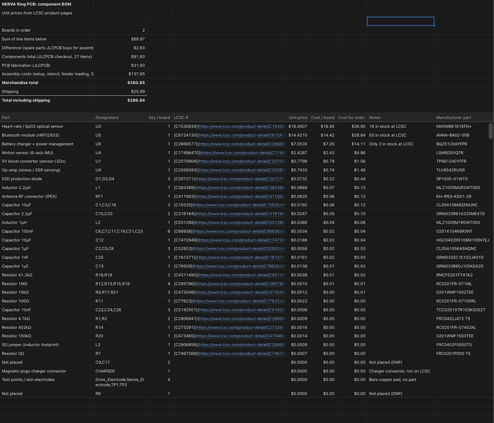

# NERVA Ring v2 - Bill of Materials

> **Source files:** [`NERVA RING-bom.csv`](NERVA%20RING-bom.csv) is the full order for 2 boards, one row per purchase including PCB, assembly and shipping (it totals $249.84 after the $37.00 I'm covering). [`BOM_v2_components.csv`](BOM_v2_components.csv) is the full component breakdown with LCSC part numbers. Prices are from the JLCPCB checkout and LCSC product pages, checked Nov 25, 2026.

## Order summary (2 boards)

| Item | Description | Cost (USD) | Supplier |
|------|-------------|-----------|----------|
| Flex PCB fabrication | Bare v2 flex PCB | $31.60 | JLCPCB |
| Components | 27 SMT line items (breakdown below) | $91.60 | JLCPCB / LCSC |
| PCB assembly | Setup, stencil, feeder loading, SMT, fixture, X-ray, packaging | $137.65 | JLCPCB |
| | **Merchandise total** | **$260.85** | |
| Shipping | | $25.99 | JLCPCB |
| | Total including shipping | $286.84 | |
| What I cover | Part of the order I'm paying for myself | −$37.00 | |
| | **Total requested** | **$249.84** | |

The line items below add up to $88.97 for 2 boards at LCSC list prices. The $2.63 difference from the $91.60 components charge is the spare parts JLCPCB buys to cover assembly loss.

## Component breakdown

| Part | Designators | Qty / board | LCSC # | Unit price | Cost / board | Manufacturer part | Notes |
|------|-------------|-------------|--------|-----------|--------------|-------------------|-------|
| Heart-rate / SpO2 optical sensor | U3 | 1 | [C1530834](https://www.lcsc.com/product-detail/C1530834.html) | $18.4507 | $18.45 | MAXM86161EFD+ | 16 in stock at LCSC |
| Bluetooth module (nRF52833) | U5 | 1 | [C6124130](https://www.lcsc.com/product-detail/C6124130.html) | $14.4210 | $14.42 | ANNA-B402-00B | 55 in stock at LCSC |
| Battery charger + power management | U6 | 1 | [C2866577](https://www.lcsc.com/product-detail/C2866577.html) | $7.0530 | $7.05 | BQ25120AYFPR | Only 2 in stock at LCSC |
| Motion sensor (6-axis IMU) | U4 | 1 | [C17496470](https://www.lcsc.com/product-detail/C17496470.html) | $2.4287 | $2.43 | LSM6DSVQTR |  |
| 5V boost converter (sensor LEDs) | U1 | 1 | [C2070904](https://www.lcsc.com/product-detail/C2070904.html) | $0.7796 | $0.78 | TPS61240YFFR |  |
| Op-amp (stress / GSR sensing) | U9 | 1 | [C2058093](https://www.lcsc.com/product-detail/C2058093.html) | $0.7433 | $0.74 | TLV8542RUGR |  |
| ESD protection diode | D1, D3, D4 | 3 | [C207271](https://www.lcsc.com/product-detail/C207271.html) | $0.0732 | $0.22 | SP1005-01WTG |  |
| Inductor 2.2µH | L1 | 1 | [C383389](https://www.lcsc.com/product-detail/C383389.html) | $0.0666 | $0.07 | MLZ1005M2R2WT000 |  |
| Antenna RF connector (IPEX) | RF1 | 1 | [C411563](https://www.lcsc.com/product-detail/C411563.html) | $0.0635 | $0.06 | KH-IPEX-K501-29 |  |
| Capacitor 10µF | C1, C3, C16 | 3 | [C15525](https://www.lcsc.com/product-detail/C15525.html) | $0.0192 | $0.06 | CL05A106MQ5NUNC |  |
| Capacitor 2.2µF | C15, C20 | 2 | [C319184](https://www.lcsc.com/product-detail/C319184.html) | $0.0247 | $0.05 | GRM033R61A225ME47D |  |
| Inductor 1µH | L2 | 1 | [C531288](https://www.lcsc.com/product-detail/C531288.html) | $0.0386 | $0.04 | MLZ1005M1R0WT000 |  |
| Capacitor 100nF | C6, C7, C11, C19, C21, C23 | 6 | [C66938](https://www.lcsc.com/product-detail/C66938.html) | $0.0034 | $0.02 | 0201X104K6R3NT |  |
| Capacitor 10µF | C12 | 1 | [C7472949](https://www.lcsc.com/product-detail/C7472949.html) | $0.0186 | $0.02 | HGC0402R5106M100NTEJ |  |
| Capacitor 1µF | C2, C5, C8 | 3 | [C52923](https://www.lcsc.com/product-detail/C52923.html) | $0.0056 | $0.02 | CL05A105KA5NQNC |  |
| Capacitor 1nF | C25 | 1 | [C161371](https://www.lcsc.com/product-detail/C161371.html) | $0.0161 | $0.02 | GRM0335C1E102JA01D |  |
| Capacitor 1µF | C13 | 1 | [C76929](https://www.lcsc.com/product-detail/C76929.html) | $0.0136 | $0.01 | GRM033R60J105KEA2D |  |
| Resistor 41.2kΩ | R18, R19 | 2 | [C4311490](https://www.lcsc.com/product-detail/C4311490.html) | $0.0038 | $0.01 | RMCF0201FT41K2 |  |
| Resistor 1MΩ | R12, R13, R15, R16 | 4 | [C295786](https://www.lcsc.com/product-detail/C295786.html) | $0.0015 | $0.01 | RC0201FR-071ML |  |
| Resistor 10kΩ | R9, R17, R21 | 3 | [C473048](https://www.lcsc.com/product-detail/C473048.html) | $0.0012 | $0.00 | 0201WMF1002TEE |  |
| Resistor 100Ω | R11 | 1 | [C77623](https://www.lcsc.com/product-detail/C77623.html) | $0.0022 | $0.00 | RC0201FR-07100RL |  |
| Capacitor 10nF | C22, C24, C26 | 3 | [C5142551](https://www.lcsc.com/product-detail/C5142551.html) | $0.0006 | $0.00 | TCC0201X7R103K500ZT |  |
| Resistor 4.7kΩ | R1, R2 | 2 | [C2906941](https://www.lcsc.com/product-detail/C2906941.html) | $0.0009 | $0.00 | FRC0402J472 TS |  |
| Resistor 402kΩ | R14 | 1 | [C273291](https://www.lcsc.com/product-detail/C273291.html) | $0.0016 | $0.00 | RC0201FR-07402KL |  |
| Resistor 150kΩ | R20 | 1 | [C473465](https://www.lcsc.com/product-detail/C473465.html) | $0.0014 | $0.00 | 0201WMF1503TEE |  |
| 0Ω jumper (inductor footprint) | L3 | 1 | [C2906858](https://www.lcsc.com/product-detail/C2906858.html) | $0.0009 | $0.00 | FRC0402F0000TS |  |
| Resistor 0Ω | R7 | 1 | [C7467269](https://www.lcsc.com/product-detail/C7467269.html) | $0.0007 | $0.00 | FRC0201P000 TS |  |
| Not placed | C9, C17 | 2 | — | — | — | — | Not placed (DNP) |
| Magnetic pogo charger connector | CHARGER | 1 | — | — | — | — | Charger connector, not on LCSC |
| Test points / skin electrodes | Drive_Electrode, Sense_Electrode, TP1, TP2 | 4 | — | — | — | — | Bare copper pad, no part |
| Not placed | R8 | 1 | — | — | — | — | Not placed (DNP) |

**Parts cost per board:** $44.48 at LCSC single-quantity prices. The sensor, Bluetooth module and charger make up about 89% of it.

